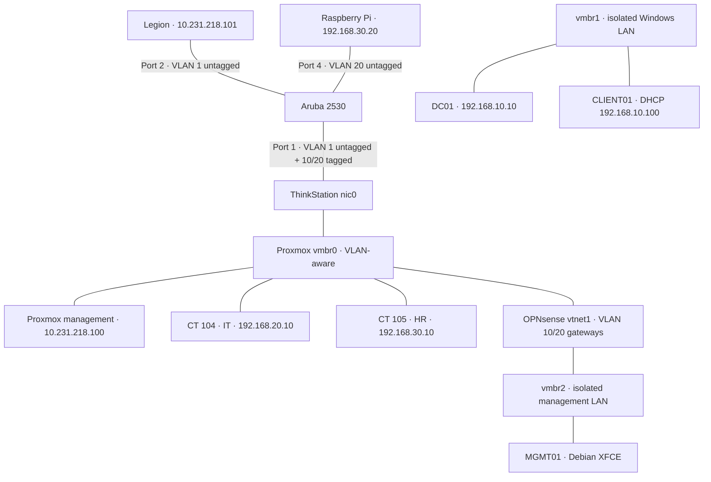
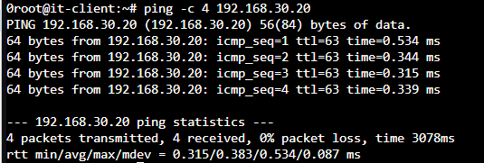

# Homelab

I've been building out a small homelab using a used Lenovo ThinkStation, an Aruba 2530 switch and a Raspberry Pi 4. I started with a Windows domain, added Group Policy and file permissions, and then spent a lot of time getting physical VLANs to work with Proxmox and OPNsense.

I wanted hands-on practice with infrastructure and networking beyond what I was doing in class. The setup is small, but I can actually configure the services, break things, trace packets and see what happens on the hardware.

**Labs 01–03 built and tested:** October 24–25, 2026

## Labs

| Lab | What I worked on | Notes |
| --- | --- | --- |
| **01 — Windows domain** | Windows Server 2025, AD DS, DNS, DHCP, Windows 11 domain client | [Lab 01](labs/01-windows-domain.md) |
| **02 — Access control** | OUs, GPOs, security groups, AGDLP, SMB and NTFS permissions | [Lab 02](labs/02-group-policy-and-files.md) |
| **03 — VLANs and routing** | OPNsense, Debian clients, Aruba 2530, 802.1Q trunk, Raspberry Pi | [Lab 03](labs/03-vlans-and-routing.md) |

I've also put together a [command cheat sheet](CHEATSHEET.md) with commands I used across the three labs.

## Hardware

| Device | What I'm using it for |
| --- | --- |
| Lenovo ThinkStation P410 — Xeon E5-1650 v4, 32 GiB RAM | Proxmox VE 9.2.2 host |
| HP / Aruba 2530-24G-PoEP (J9773A) | VLANs, access ports and tagged uplink |
| Lenovo Legion 5 | Management, PowerShell, PuTTY and Wireshark |
| Raspberry Pi 4 | Physical Linux client on VLAN 20 |

The ThinkStation runs Windows Server 2025, Windows 11, OPNsense 26.7 and Debian 13 VMs, plus two small Debian LXC containers.

## Network layout

This is how everything was connected at the end of Lab 03. The IT and HR VLANs started on the isolated `vmbr2` bridge and were moved to `vmbr0` when I connected the Aruba.

| Network | Purpose | Addressing |
| --- | --- | --- |
| Untagged / VLAN 1 | ThinkStation and Legion management | `10.231.218.0/24` |
| `vmbr1` | Isolated Windows domain | `192.168.10.0/24` |
| `vmbr2` | OPNsense management | `192.168.1.0/24` |
| VLAN 10 | IT | `192.168.20.0/24` |
| VLAN 20 | HR and Raspberry Pi | `192.168.30.0/24` |

The Aruba and Proxmox bridges switch frames within their VLANs. OPNsense handles routing and firewall rules between IT and HR.

## Tests and results

- Joined a Windows 11 VM to `lab.home.arpa` and signed in with an account created on DC01.
- Applied a Group Policy that blocked Control Panel for the HR user while leaving it available for the IT user on the same VM.
- Created an HR file share with group-based permissions. HR could create a file; IT was denied access.
- Allowed IT to initiate ICMP traffic to HR while blocking new HR-initiated ICMP requests. Checked the results in OPNsense's firewall logs.
- Captured 802.1Q-tagged frames and watched packets cross from VLAN 10 to VLAN 20.
- Connected the virtual VLANs to the physical Aruba and reached the Raspberry Pi from both containers. IT's traffic went through OPNsense; HR reached the Pi directly on VLAN 20.

I've included the troubleshooting in the lab pages as well. There were a few obvious mistakes, along with some less obvious problems involving DNS, an OPNsense interface that wasn't enabled, Proxmox trunk membership and the Raspberry Pi's network configuration.

## What's next

I want to set up DHCP for each VLAN, tighten the firewall rules, get proper configuration backups in place, and make deployments easier to repeat. I've only just started building out this homelab, and there's plenty more I want to do with it.

[Lab 01](labs/01-windows-domain.md) · [Lab 02](labs/02-group-policy-and-files.md) · [Lab 03](labs/03-vlans-and-routing.md) · [Command cheat sheet](CHEATSHEET.md)
