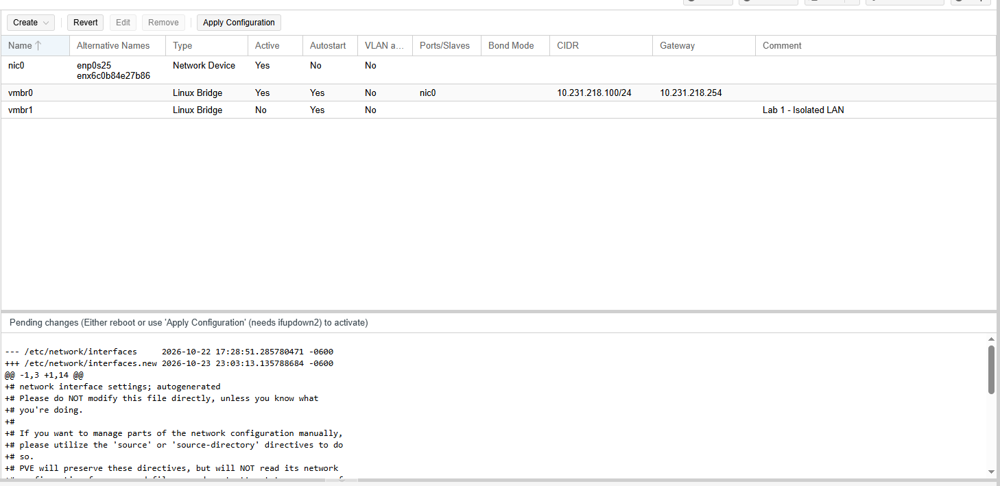
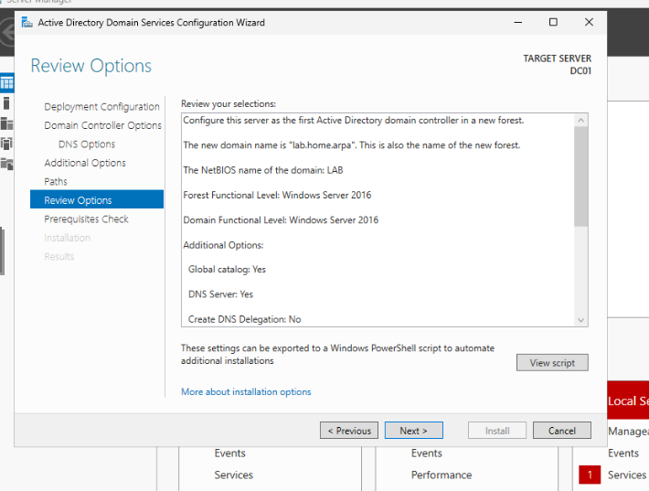
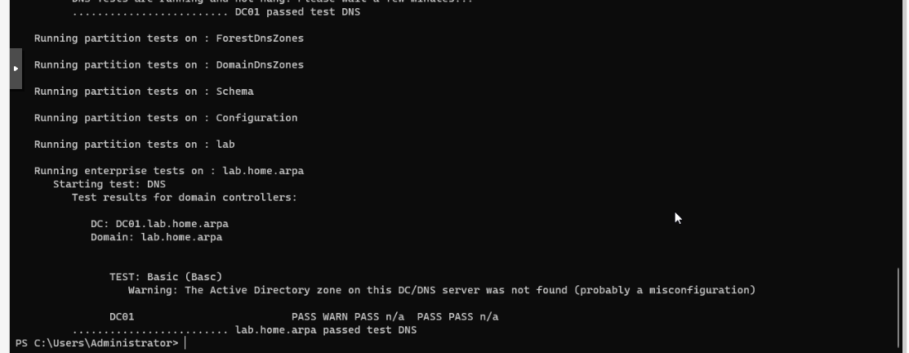
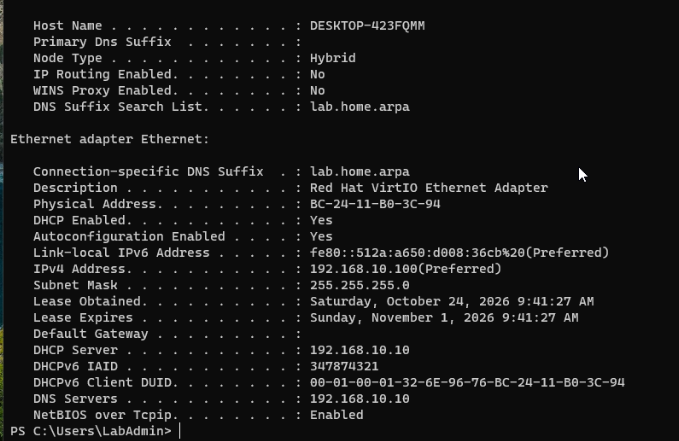
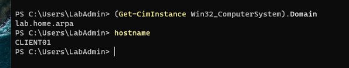
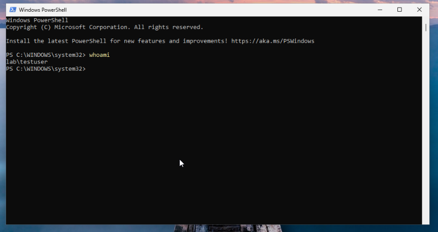

# Lab 01 — Windows Server, Active Directory, DNS and DHCP

[← Back to overview](../README.md) · [Command cheat sheet](../CHEATSHEET.md)

For the first lab, I set up a Windows Server domain controller and a Windows 11 client on an isolated Proxmox network. I wanted to get the client joined to the domain and sign in with an account created on the server.

I worked on this after an overnight shift. Most of the setup was done in one morning, with a bit of extra time spent on DNS and the domain join.

## The setup

| Item | Configuration |
| --- | --- |
| Hypervisor | Proxmox VE 9.2.2 |
| Virtual bridge | `vmbr1`, no physical uplink |
| DC01 / VM 100 | Windows Server 2025, `192.168.10.10/24` |
| CLIENT01 / VM 101 | Windows 11, DHCP address `192.168.10.100/24` |
| AD domain | `lab.home.arpa` (NetBIOS: `LAB`) |
| DNS | DC01 itself, `192.168.10.10` |
| DHCP scope | `192.168.10.100–192.168.10.199` |
| Default gateway | Not configured for this isolated subnet |

The bridge has no external ports. That's intentional: the Windows domain doesn't need a connection to the physical switch for this lab.



## Build

I created `DC01` and `CLIENT01`, both connected to `vmbr1` using VirtIO network adapters. Windows Server initially couldn't see its virtual disk, so I loaded the VirtIO storage driver from the separate driver ISO during installation. Once Windows was installed, I added the guest drivers/tools and set a static IP.

Next came Active Directory Domain Services and DNS. I promoted DC01 as the first domain controller in a new forest, `lab.home.arpa`. The AD DS review screen showed a `LAB` NetBIOS name and Windows Server 2016 forest/domain functional levels.



After promotion, I configured DHCP on DC01 and enabled a scope for the Windows client. The client receives its IPv4 address automatically, but gets DC01 as its DNS server. AD clients use DNS SRV records to locate domain controllers, so pointing the client at the correct DNS server matters.

## Tests

On DC01:

```powershell
Get-DnsServerZone
Get-DnsServerResourceRecord -ZoneName 'lab.home.arpa'
Resolve-DnsName dc01.lab.home.arpa -Server 192.168.10.10
dcdiag /test:DNS
```

The first DNS diagnostics reported missing registrations and connectivity errors. Later checks resolved `dc01.lab.home.arpa`, and `dcdiag /test:DNS` passed its DNS test (with a warning still visible in the report). I kept that detail because a passing headline doesn't mean every warning disappeared.



On CLIENT01:

```powershell
ipconfig /all
Resolve-DnsName dc01.lab.home.arpa
```

The DHCP lease came through as `192.168.10.100`, with `192.168.10.10` listed as the DHCP server and DNS server.



## Domain join: one operation, two errors

I used PowerShell for the domain join instead of the GUI. The first attempt returned **Access is denied** because PowerShell wasn't elevated. After opening an administrator shell, the domain join succeeded, but the combined rename failed with **The directory service is busy**.

The fix was to restart, confirm domain membership, then rename the machine separately. I checked the result before trying anything else, since the join had already completed.

```powershell
# Elevated PowerShell — domain join
Add-Computer -DomainName 'lab.home.arpa' -Credential 'LAB\Administrator' -Restart

# Rename separately if necessary
Rename-Computer -NewName 'CLIENT01' -DomainCredential 'LAB\Administrator' -Restart

# Verify after restart
hostname
(Get-CimInstance Win32_ComputerSystem).Domain
```



Finally, I created `testuser` on DC01, logged into CLIENT01 using `LAB\testuser`, and ran `whoami`.

```text
lab\testuser
```



## Notes

- I checked IP assignment, hostname resolution, DC discovery and user authentication separately. Each can fail independently.
- A domain controller should have a stable IP and functional AD DNS records.
- Windows Server needed VirtIO storage drivers at install time; the Linux guests later didn't.
- The client can join a domain even if a subsequent rename fails. Verify the actual state before rerunning anything.
- I saved snapshots after the working milestones. I still need separate backups for disk failure or other host-level problems.

**Result:** DC01 runs AD DS, DNS and DHCP. CLIENT01 receives a lease and signs in with a domain user.

**Next:** [Lab 02 — Group Policy and file permissions](02-group-policy-and-files.md)
