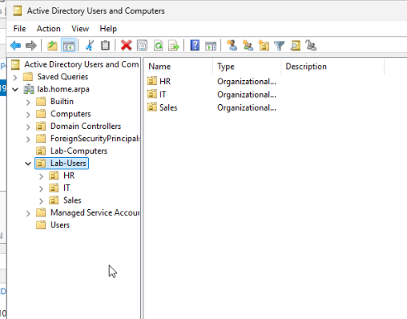
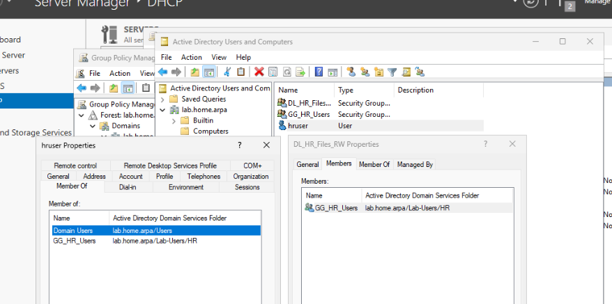
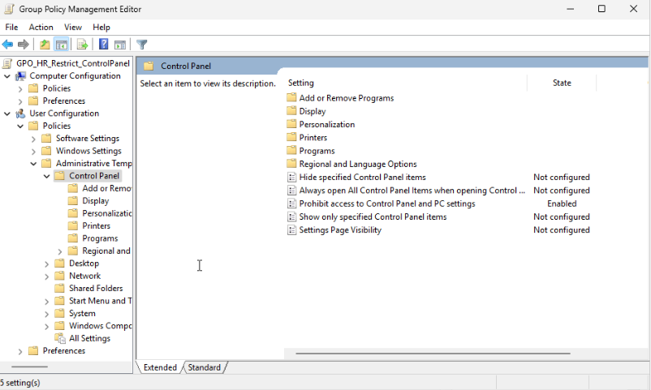
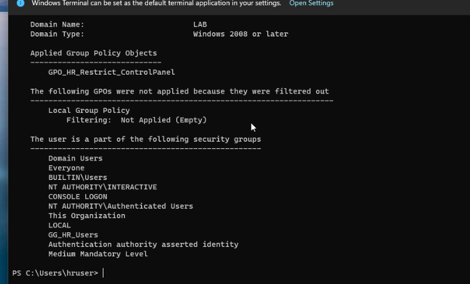
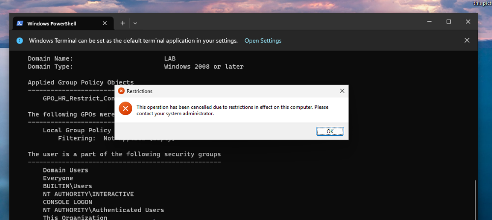
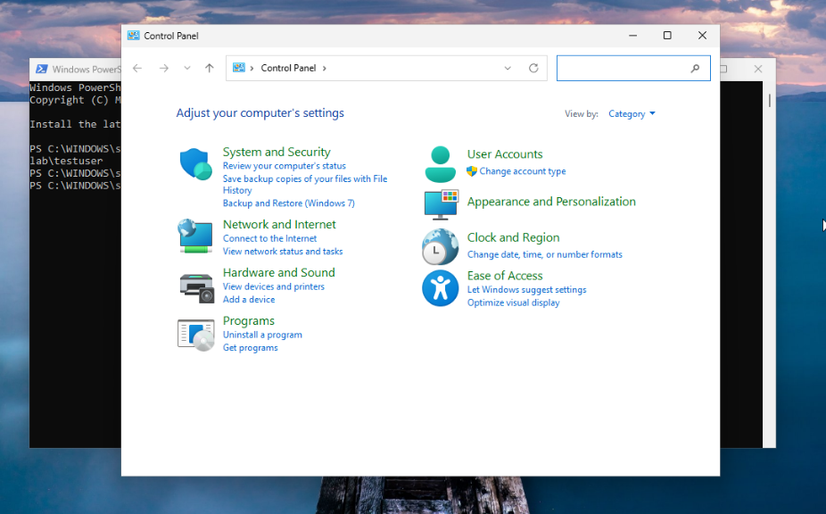
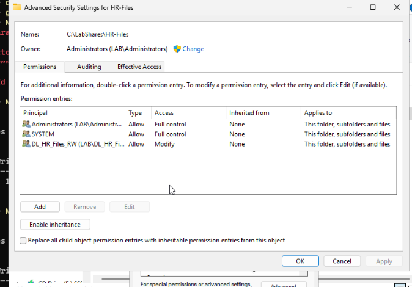
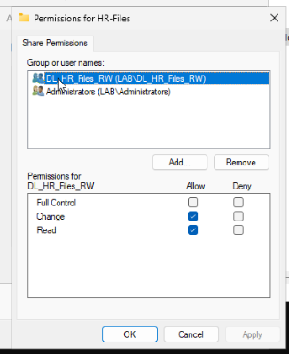
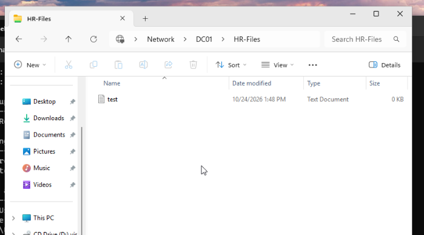
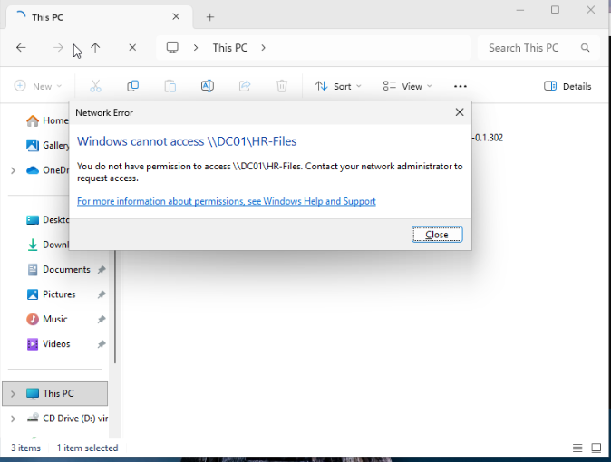

# Lab 02 — Group Policy and file permissions

[← Back to overview](../README.md) · [Previous lab](01-windows-domain.md) · [Command cheat sheet](../CHEATSHEET.md)

With the domain running, I used Lab 02 to configure user policies and file access. Everything was done on the same DC01 and CLIENT01 VMs.

## OUs and groups

I created departmental organizational units and moved the existing Windows 11 computer into its own OU:

```text
lab.home.arpa
├── Domain Controllers
│   └── DC01
├── Lab-Computers
│   └── CLIENT01
└── Lab-Users
    ├── IT
    │   ├── testuser
    │   └── GG_IT_Users
    ├── HR
    │   ├── hruser
    │   ├── GG_HR_Users
    │   └── DL_HR_Files_RW
    └── Sales
        └── GG_Sales_Users
```



The group names reflect their roles: `GG_` for a **global** security group (who belongs to a department), and `DL_` for a **domain-local** security group (who gets access to a resource).

For the HR share, the chain is:

```text
hruser → GG_HR_Users → DL_HR_Files_RW → HR-Files permissions
```

This follows **AGDLP** (Accounts → Global → Domain Local → Permissions). Adding another HR user only requires changing the global group membership; the file ACL stays the same.



## A Group Policy that actually changes something

I created `GPO_HR_Restrict_ControlPanel`, linked it to the **HR OU**, and enabled this user setting:

`User Configuration → Policies → Administrative Templates → Control Panel → Prohibit access to Control Panel and PC settings`



Then I signed into CLIENT01 with `LAB\hruser` and ran:

```powershell
gpupdate /force
gpresult /r /scope user
control.exe
```

`gpresult` listed the HR-specific GPO as applied, and Windows blocked Control Panel with its normal administrative restriction message.





I signed out and tested `LAB\testuser` on **the same CLIENT01 VM**. Control Panel opened normally. The restriction followed the HR account's OU. I didn't have to change any local setting on CLIENT01 between logins.



## HR file share using AGDLP

On DC01, I created `C:\LabShares\HR-Files` and shared it as `\\DC01\HR-Files`.

| Permission layer | Entries |
| --- | --- |
| **NTFS** on `HR-Files` | `SYSTEM` and `Administrators`: Full Control; `DL_HR_Files_RW`: Modify |
| **SMB share** | `Administrators`: Full Control; `DL_HR_Files_RW`: Change + Read |
| Inheritance | Disabled on `HR-Files` |
| Broad share access | Removed `Everyone` from the share ACL |

Windows checks both SMB share permissions and NTFS permissions for access over the network. I assigned permissions to the domain-local group, so I can manage HR membership without editing the folder ACL.

One mistake I caught during setup: I initially put the HR ACL on the parent `C:\LabShares` folder. That would have been the wrong place once other department folders were created. I removed it from the parent and applied it to `HR-Files` itself.





## Testing both outcomes

From CLIENT01, signed in as `LAB\hruser`, I opened `\\DC01\HR-Files` and created a text file.



Then I switched to `LAB\testuser` and tried the same network path. Windows returned **You do not have permission to access this share**.



I allowed access for the HR resource group and administrators. Since the IT account wasn't included, its access attempt failed without an explicit deny rule.

## Notes

- OUs are useful for **organizing accounts and targeting GPOs**. They're not file-access permission groups.
- Group membership and resource permissions are easier to maintain separately using AGDLP.
- For SMB access, share permissions and NTFS ACLs both matter.
- I tested access with both the HR and IT accounts. The IT test was useful for catching overly broad permissions.

**Result:** The HR GPO applied to HR users. HR could create files on the share, and IT was denied access.

**Next:** [Lab 03 — VLANs and physical networking](03-vlans-and-routing.md)
