# Lab 03 — VLANs, OPNsense and the Aruba 2530

[← Back to overview](../README.md) · [Previous lab](02-group-policy-and-files.md) · [Command cheat sheet](../CHEATSHEET.md)

I started Lab 03 with virtual VLANs in Proxmox and OPNsense. After those worked, I configured VLANs on the Aruba 2530 and connected them to the virtual environment. The Raspberry Pi added quite a bit of troubleshooting along the way.

I worked through the virtual VLANs first, then tested VLAN isolation on physical switch ports, and finally connected the Aruba to Proxmox.

## Final addressing

| Network | Gateway / interface | Clients |
| --- | --- | --- |
| Management (untagged) | Proxmox `10.231.218.100/24` | Legion `10.231.218.101/24` |
| OPNsense management | `vtnet0`, `192.168.1.1/24`, on `vmbr2` | MGMT01, Debian XFCE |
| **VLAN 10 — IT** | OPNsense `vlan01`, `192.168.20.1/24` | `it-client` / CT 104: `192.168.20.10` |
| **VLAN 20 — HR** | OPNsense `vlan02`, `192.168.30.1/24` | `hr-client` / CT 105: `192.168.30.10`; Pi: `192.168.30.20` |

At the end of the lab, `vlan01` and `vlan02` used `vtnet1`, and both containers were connected to VLAN-aware `vmbr0`. Early screenshots show `vtnet0` and `vmbr2` because that was the initial virtual-only setup.

## Part 1 — The virtual network

I installed **OPNsense 26.7** as VM 102, then created **MGMT01**, a Debian 13 XFCE workstation on the same untagged management bridge. Its job was to provide a browser and Linux networking tools without involving the Windows domain.

Two smaller Debian 13 LXC containers provided the test endpoints. Proxmox assigned their virtual NICs VLAN tags 10 and 20, so the containers themselves didn't need to tag frames.

In OPNsense I created two VLAN devices and assigned IPv4 addresses:

| OPNsense device | VLAN ID | Interface label | Address |
| --- | --- | --- | --- |
| `vlan01` | 10 | IT | `192.168.20.1/24` |
| `vlan02` | 20 | HR | `192.168.30.1/24` |

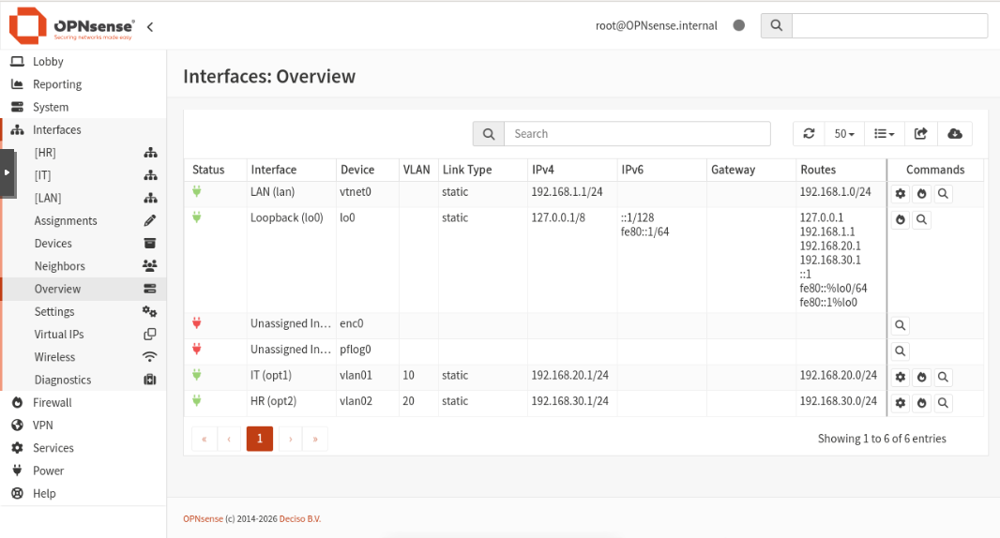

I checked the **directly connected routes** with `netstat -rn -f inet`. OPNsense already had an interface in each subnet, so I didn't need to add static routes between them.

The first gateway pings failed because the new interfaces had no ICMP pass rules. I added a rule on each interface allowing clients to ping their own gateway, applied the changes, and got replies from both.

### Stateful rules

I then added an **inbound rule on IT** allowing IPv4 ICMP Echo Requests from `IT net` to `HR net`. I didn't add the reverse rule on HR.

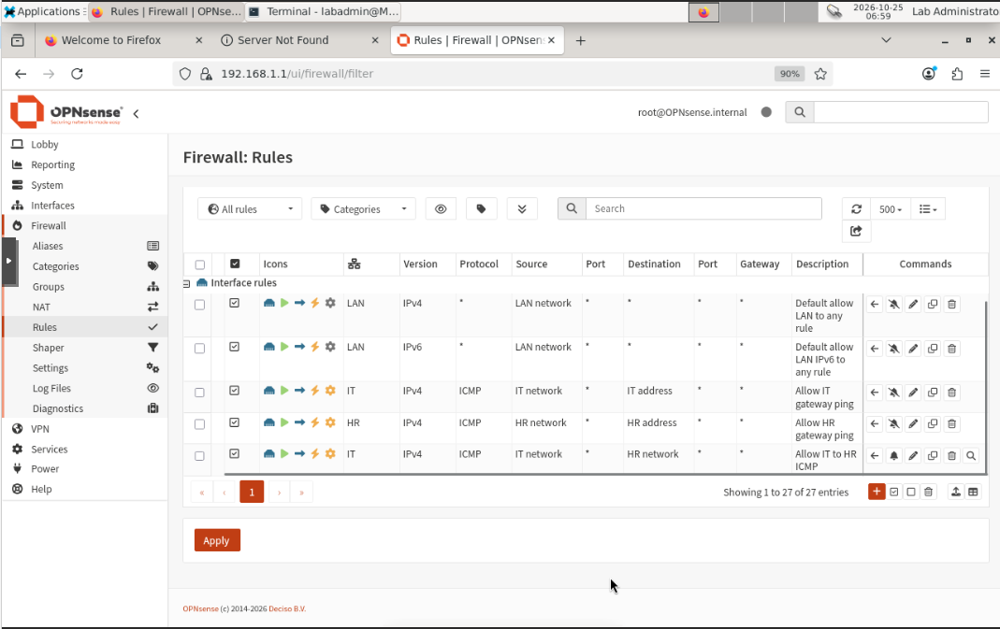

The result:

| Test | Result |
| --- | --- |
| IT (`192.168.20.10`) → HR (`192.168.30.10`) | 4/4 Echo Replies |
| HR (`192.168.30.10`) → IT (`192.168.20.10`) | 0/4 Echo Replies |

The allowed IT ping created a firewall state that permitted the Echo Replies from HR. Separate Echo Requests initiated by HR hit the default-deny rule.

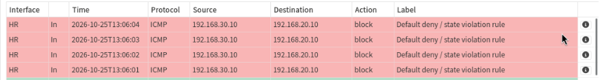

### Seeing the tags in a capture

On the OPNsense shell:

```sh
tcpdump -eni vtnet0 'vlan and icmp'
```

At that stage, `vtnet0` was the VLAN trunk inside the virtual lab. `-e` included Ethernet headers, `-n` kept addresses numeric, and `-i` selected the capture interface.

The output showed the same ICMP request on VLAN 10 before routing and on VLAN 20 after routing. The IP endpoints stayed the same; the MAC addresses and 802.1Q tag changed. Replies followed the reverse path.

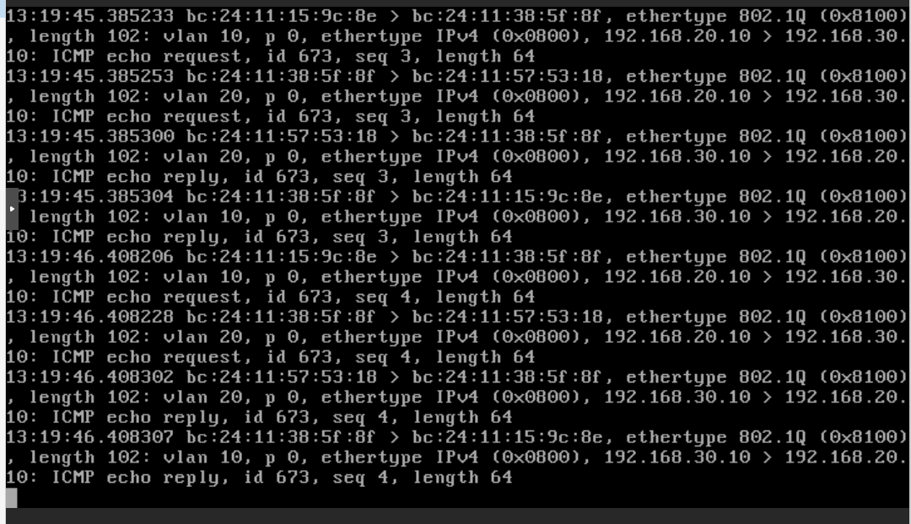

`0x8100` marks the 802.1Q tag, `vlan 10`/`vlan 20` identifies the VLAN, `p 0` is the priority, and `0x0800` says the payload is IPv4.

## Part 2 — Using the physical Aruba switch

The switch is an **HP/Aruba 2530-24G-PoEP (J9773A)**. I connected to its micro-USB console using PuTTY over a serial COM port, then checked `show version`, `show vlans` and `show interfaces brief` before changing anything.

The initial configuration only had VLAN 1. I created **VLAN 10 (IT)** and **VLAN 20 (HR)** and configured physical access ports.

```text
configure terminal
vlan 10
 name IT
 exit
vlan 20
 name HR
 exit
vlan 10 untagged 3
vlan 20 untagged 4
show vlans 10
show vlans 20
```

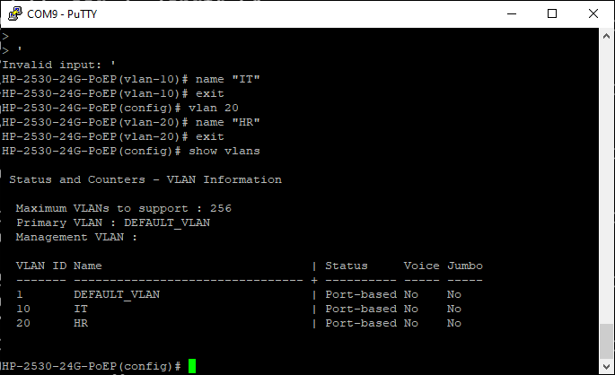

On the Aruba, **untagged** ports carry ordinary Ethernet frames for one VLAN. The uplink uses **tagged** traffic so VLANs 10 and 20 can share one cable. It works like access ports and a trunk in Cisco terminology, although the commands are different.

### Testing VLAN isolation with two physical devices

I used the Legion on Aruba **port 5** and the Raspberry Pi on **port 4**. Both temporarily used the `192.168.50.0/24` subnet. Moving only port 5 between VLANs gave a clear test:

| Switch configuration | Result |
| --- | --- |
| Ports 4 + 5 in VLAN 20 | Ping and SSH worked |
| Port 4 in VLAN 20, port 5 in VLAN 10 | Ping failed |
| Both back in VLAN 20 | Ping worked again |

Both devices kept their IP addresses during the test. Once I put them on different VLANs, their ARP requests could no longer reach each other.

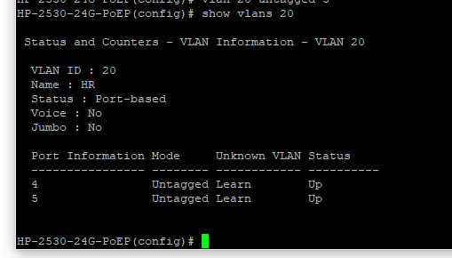

### The Raspberry Pi detour

I didn't have an HDMI adapter for the Pi and wasn't sure what was installed on its SD card. The switch's MAC table showed the Pi transmitting. In Wireshark, its mDNS advertisements revealed `raspberrypi.local` and an IPv6 link-local address. That got me far enough to attempt SSH.

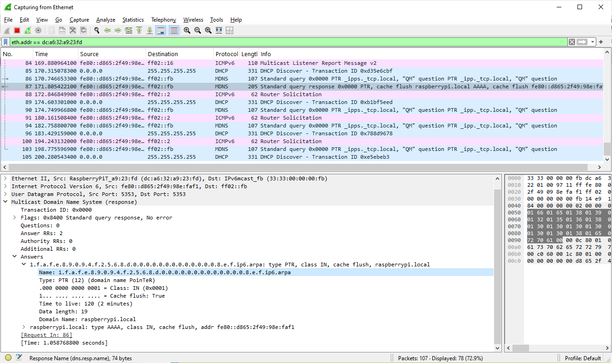

SSH was initially unavailable. I used an old Galaxy S7 Edge as a microSD reader, added the `ssh` file to the Pi's boot partition, and then connected over SSH. The installation was Raspberry Pi OS based on Debian Bookworm, from 2024.

The Pi also had intermittent connection failures. I tested it with a direct Ethernet cable, tried a different power adapter and reverted an old 2 GHz overclock. I never established a single cause for all of the disconnects.

The one issue I could pin down was NetworkManager repeatedly trying DHCP when the isolated test network had no DHCP server. The address I set with `ip addr add` would disappear when the connection reactivated. Saving a static address through `nmcli` kept it in the connection profile and solved the disappearing IPv4 address.

## Part 3 — Connecting Aruba and Proxmox

The ThinkStation has one physical NIC connected to the switch, so the plan was to carry management traffic untagged and IT/HR traffic tagged over the same cable. I kept Proxmox management at `10.231.218.100`.

### Switch uplink

Aruba **port 1** connects to the ThinkStation:

```text
vlan 10 tagged 1
vlan 20 tagged 1
show vlans 1
show vlans 10
show vlans 20
write memory
```

Port 1 kept VLAN 1 untagged and carried VLANs 10 and 20 with 802.1Q tags. Port 2 stayed on VLAN 1 for the Legion.

### Proxmox and OPNsense

I made `vmbr0` VLAN-aware and added a **second VirtIO NIC** to OPNsense (`net1` / `vtnet1`), connected to `vmbr0`.

Relevant Proxmox bridge settings:

```ini
bridge-vlan-aware yes
bridge-vids 2-4094
```

The OPNsense VM NIC also needed an explicit `trunks=10;20` setting. Before that, Proxmox showed only `1 PVID Egress Untagged` on `tap102i1`, so the tagged VLANs weren't admitted to the VM port.

```sh
bridge vlan show dev tap102i1
```

After fixing it, the output included **VLAN 1 untagged, VLAN 10 tagged, VLAN 20 tagged**.

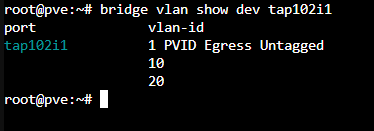

`vtnet1` was also initially **administratively DOWN**. I assigned it as `PHYSICAL_TRUNK` in OPNsense, enabled it and left it without an IP address. The gateway IPs stayed on the VLAN interfaces.

Finally, I moved the existing `vlan01`/`vlan02` parent from `vtnet0` to `vtnet1` and moved CT 104/105 from `vmbr2` to `vmbr0`, preserving their VLAN tags and IP addresses.

**Troubleshooting:** I spent more time than necessary capturing packets while the OPNsense interface was down and the Proxmox tap port admitted only VLAN 1. Enabling the interface, allowing VLANs 10 and 20 on the VM NIC, and applying the pending changes fixed that part.

### A container talking to an actual Pi

With the Pi on Aruba port 4 (VLAN 20), I temporarily gave HR-CLIENT a second address in the same test subnet. It successfully pinged and SSH'd into the physical Pi through the Proxmox–Aruba trunk.

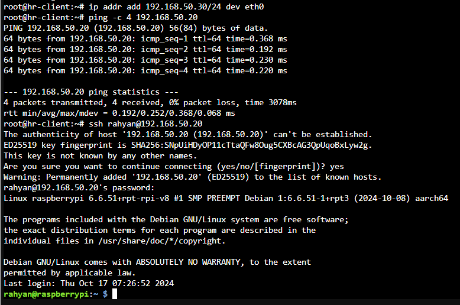

For the final setup, I removed that temporary test subnet. The Pi now uses `192.168.30.20/24` on VLAN 20. It also needs a route **back to IT** through OPNsense, because IT is a different subnet:

```sh
sudo nmcli con mod 'Wired connection 1' \
  ipv4.method manual \
  ipv4.addresses '192.168.30.20/24' \
  ipv4.gateway '' \
  ipv4.routes '192.168.20.0/24 192.168.30.1'
sudo nmcli con up 'Wired connection 1'
ip route get 192.168.20.10
```

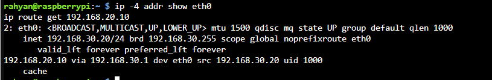

## Final test

From `it-client` (VLAN 10), I pinged the physical Pi on `192.168.30.20` (VLAN 20). From `hr-client`, I pinged the same Pi without crossing a router.

| Source | Result | TTL of Echo Reply |
| --- | --- | --- |
| IT → Pi | **4/4 received, 0% loss** | `63` |
| HR → Pi | **4/4 received, 0% loss** | `64` |

The IT reply crossed OPNsense once, which accounts for TTL 63. The HR reply stayed inside VLAN 20 and arrived with TTL 64. I also checked the gateway configuration and the Pi's route back to IT.

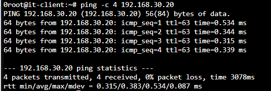

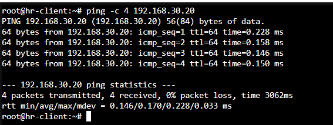

## Notes

- A VLAN is a **Layer 2 broadcast domain**. Its ID and the subnet's IP numbers don't have to match.
- Routers know directly connected networks from the addresses on their interfaces. Firewall rules decide which traffic is allowed to use those routes.
- I had to configure VLAN membership on the Aruba uplink, the Proxmox bridge, the VM tap port and the OPNsense interfaces.
- Proxmox bridges and the physical Aruba both switch Ethernet frames; OPNsense routes between subnets.
- Capturing on the physical NIC showed frames that weren't yet being admitted to OPNsense. I had to check each point along the path.
- My troubleshooting order now is **link → administrative UP → VLAN membership → IP/routes → firewall**. Packet captures come after those basics.

**Result:** IT can reach the physical Pi through OPNsense, and HR can reach it on its own VLAN. I saved the switch configuration and took snapshots of the working setup.

[← Back to overview](../README.md)
